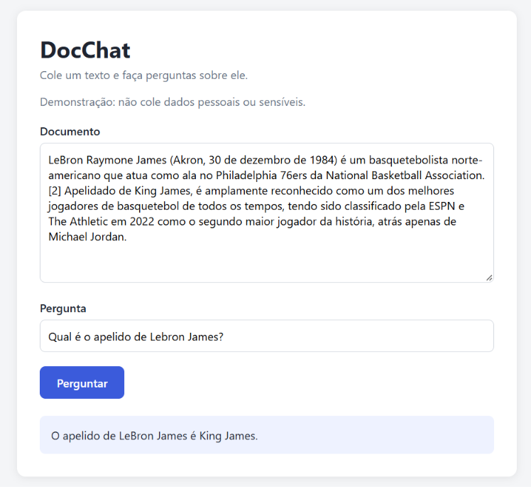

# 📄 DocChat

Aplicação web de perguntas e respostas sobre documentos com inteligência artificial. Você cola um texto, faz uma pergunta e recebe a resposta baseada **somente** naquele conteúdo, em streaming.

---

## 🚀 Tecnologias utilizadas

- Python
- FastAPI
- Google Gemini (SDK `google-genai`)
- JavaScript (ES6+)
- HTML5
- CSS3

---

## ✨ Funcionalidades

- 💬 Perguntas sobre qualquer texto colado
- ⚡ Respostas em streaming (o texto aparece conforme o modelo escreve)
- 🛡️ A IA só usa o documento: se a informação não existe, ela avisa em vez de inventar
- ✅ Validação de entrada e tratamento de erros na API
- 🔌 API REST com documentação automática (Swagger)

---

## 📷 Preview



---

## 🔗 Acesse o projeto

👉 https://docchat-c328.onrender.com/

> ⏳ O servidor gratuito dorme após um tempo sem uso, então o primeiro acesso pode levar cerca de um minuto.

---

## 📂 Como rodar o projeto

Pré-requisitos: Python 3.10+ e uma chave gratuita da API do Gemini, criada em [aistudio.google.com](https://aistudio.google.com).

```bash
# Clonar o repositório
git clone https://github.com/SEU_USUARIO/docchat.git

# Entrar na pasta
cd docchat

# Criar e ativar o ambiente virtual
python -m venv .venv
.venv\Scripts\activate

# Instalar dependências
pip install -r requirements.txt

# Criar o arquivo de variáveis de ambiente
copy .env.example .env

# Abra o .env e coloque sua chave em GEMINI_API_KEY

# Rodar o projeto
uvicorn main:app --reload
```

Depois acesse:

- Interface: http://127.0.0.1:8000/app/
- Documentação da API: http://127.0.0.1:8000/docs

> No Linux ou macOS, ative o ambiente com `source .venv/bin/activate` e copie o arquivo com `cp .env.example .env`.

---

## 🔌 Endpoints

| Método | Rota | Descrição |
|---|---|---|
| GET | `/health` | Verifica se o servidor está no ar |
| POST | `/ask` | Retorna a resposta completa em JSON |
| POST | `/ask/stream` | Retorna a resposta em streaming |

Exemplo de requisição:

```json
{
  "document": "A Agatha trabalha na empresa Acme desde 2020.",
  "question": "Onde a Agatha trabalha?"
}
```

---

## 🗂️ Estrutura do projeto

```
docchat/
├── frontend/        # interface (HTML, CSS e JavaScript)
├── docs/            # imagens do README
├── llm.py           # integração com o modelo de IA
├── main.py          # API FastAPI
├── requirements.txt
└── .env.example
```

---

## 🧠 Decisões de projeto

- **Integração com a IA isolada em `llm.py`:** o resto do código não depende do provedor, então trocar de modelo mexe em um arquivo só.
- **System prompt separado da pergunta:** o comportamento do assistente é fixo, e só o documento e a pergunta mudam a cada chamada.
- **Frontend servido pelo próprio FastAPI:** evita problemas de CORS e simplifica a execução e o deploy.
- **Limites de tamanho nos campos:** protegem a cota da API contra textos gigantes.
- **Chave de API em variável de ambiente:** nunca vai para o repositório.

---

## 🔮 Próximos passos

- Upload de arquivos PDF e TXT
- Histórico de conversa
- Testes automatizados
